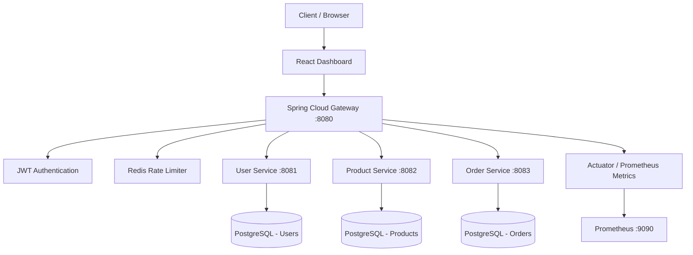

# CodeLens — API Gateway & Redis Rate Limiting Platform

A containerized microservices platform built with **Java, Spring Boot, Spring Cloud Gateway, Redis, PostgreSQL, and React**. CodeLens demonstrates centralized API routing, JWT-based authentication, distributed rate-limit state, service separation, and application monitoring.

## Overview

CodeLens provides a single entry point for requests to multiple backend services. The gateway handles request routing and authentication, while Redis stores rate-limit state. Separate services manage users, products, and orders, each with its own PostgreSQL database.

### Key Features

- **Centralized API Gateway:** Route requests to backend microservices through Spring Cloud Gateway.
- **JWT Authentication:** Validate JWT-based authentication at the gateway.
- **Redis-backed Rate Limiting:** Track request counts using Redis and atomic Lua-based operations.
- **Per-client Rate Limits:** Use authenticated usernames for user-specific limits and client IP addresses for unauthenticated requests.
- **HTTP 429 Responses:** Reject requests when the configured rate limit is exceeded.
- **Microservices Architecture:** Keep user, product, and order functionality in separate services.
- **Monitoring:** Integrate Spring Boot Actuator and Prometheus metrics.
- **Interactive Dashboard:** React-based frontend with service status, metrics, and charts.

## Architecture



### Request Flow

1. A client sends a request to the API Gateway.
2. The gateway applies JWT authentication according to the configured security rules.
3. The rate limiter identifies the client and checks the Redis-backed request counter.
4. Allowed requests are routed to the appropriate backend service.
5. Requests exceeding the configured limit receive HTTP `429 Too Many Requests`.
6. Application metrics are exposed for monitoring.

## Technology Stack

| Layer | Technologies |
|---|---|
| Backend | Java, Spring Boot |
| API Gateway | Spring Cloud Gateway |
| Authentication | JWT |
| Rate Limiting | Redis, atomic Lua operations |
| Databases | PostgreSQL |
| Frontend | React, Vite, Tailwind CSS, Recharts |
| Infrastructure | Docker, Docker Compose |
| Monitoring | Prometheus, Spring Boot Actuator |

## Services and Ports

| Component | Port | Purpose |
|---|---:|---|
| API Gateway | `8080` | Central request entry point |
| User Service | `8081` | User and authentication operations |
| Product Service | `8082` | Product operations |
| Order Service | `8083` | Order operations |
| Redis | `6379` | Rate-limit state |
| Prometheus | `9090` | Metrics monitoring |
| Users PostgreSQL | `5433` on host | User database |
| Products PostgreSQL | `5434` on host | Product database |
| Orders PostgreSQL | `5435` on host | Order database |

## Rate Limiting

The current development configuration allows **5 requests per 60-second window** for each rate-limit key.

- Authenticated requests are keyed by username.
- Unauthenticated requests are keyed by client IP.
- Redis maintains the request counter.
- Requests beyond the configured limit are rejected with HTTP `429`.

The implementation uses atomic Redis operations to update request counts. Rate-limit behavior has been manually verified in the development environment, including separate limits for different authenticated users.

## API Routes

The gateway uses the following route prefixes:

| Gateway route | Backend |
|---|---|
| `/api/users/**` | User Service |
| `/api/products/**` | Product Service |
| `/api/orders/**` | Order Service |

The gateway removes the `/api` prefix before forwarding requests. Exact endpoint paths and authorization requirements depend on the individual service and gateway configuration.

## Getting Started

### Prerequisites

- Docker Desktop with Docker Compose
- Node.js and npm for frontend development
- Java and Maven if building backend services locally

### 1. Configure Environment Variables

Create a local `.env` file in the project root. Configure the variables required by Docker Compose, including:

```dotenv
JWT_SECRET=replace_with_a_strong_random_secret
DB_PASSWORD=your_database_password
```

Use your existing database credentials when working with initialized databases. Configure a strong JWT signing secret appropriate for your environment.

**Never commit `.env` or real credentials to Git.** The root `.gitignore` excludes `.env`.

### 2. Start the Backend Stack

From the project root:

```powershell
docker compose up -d --build
```

Check container status:

```powershell
docker compose ps
```

Inspect service logs when troubleshooting:

```powershell
docker compose logs --tail 100 gateway
docker compose logs --tail 100 user-service
docker compose logs --tail 100 product-service
docker compose logs --tail 100 order-service
```

### 3. Check Gateway Health

```powershell
Invoke-RestMethod http://localhost:8080/actuator/health
```

The endpoint's availability depends on the configured Actuator exposure and runtime status.

### 4. Start the Frontend

Open a separate terminal:

```powershell
cd frontend
npm install
npm run dev
```

Use the local URL printed by Vite to open the dashboard.

### 5. Build the Frontend

```powershell
npm run build
```

The production build has completed successfully in the development environment. Vite reported a large JavaScript chunk warning that may be addressed through later bundle optimization.

## Project Structure

```text
API_GATEWAY/
├── gateway/          # API gateway, JWT security, rate limiting, metrics
├── user-service/     # User service
├── product-service/  # Product service
├── order-service/    # Order service
├── frontend/         # React dashboard
├── docker-compose.yml
├── prometheus.yml
├── .gitignore
└── README.md
```

## Verification Status

The following have been verified in the development environment:

- JWT authentication behavior at the gateway.
- Redis rate limiting and isolation between authenticated users.
- HTTP `429` responses after the configured request limit is exceeded.
- Docker Compose configuration validation.
- Successful frontend production build.
- Git repository setup and source-code publication.

These checks do not establish production readiness or a production deployment.

## Security and Production Considerations

CodeLens is currently a development and demonstration project. Before production use, review:

- JWT secret management and token lifecycle.
- Authentication and authorization rules for every route.
- Rate-limit behavior behind reverse proxies and load balancers.
- Actuator and Prometheus endpoint access controls.
- HTTPS, CORS, and network security.
- PostgreSQL credential management and database migrations.
- Redis availability, persistence, and failure behavior.
- Frontend bundle size and production deployment configuration.

## Future Improvements

- Add architecture and dashboard screenshots.
- Optimize frontend bundle splitting.
- Document exact API request and response examples.
- Add automated build and continuous integration workflows.
- Improve production deployment and observability configuration.
